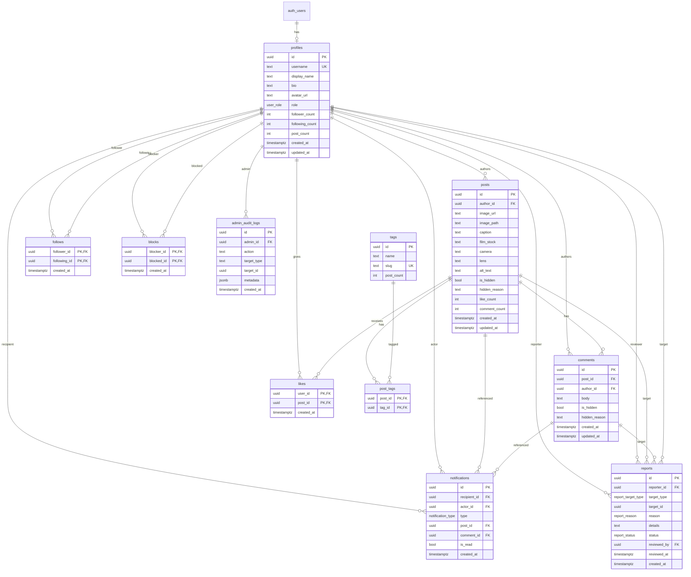

# Lensa — Entity Relationship Diagram

Dibuat: Fase 1. Dirender otomatis oleh GitHub & VS Code.

## Keputusan Desain

| # | Keputusan | Alasan |
|---|---|---|
| D1 | Profile dibuat saat onboarding, bukan signup | Username wajib; hindari profil setengah jadi |
| D2 | Denormalized counters + trigger | Feed & profil cepat; hindari COUNT(*) |
| D3 | `image_path` terpisah dari `image_url` | Perlu untuk delete di Storage |
| D4 | `reports.target_id` tanpa FK (polymorphic) | Divalidasi di Server Action |
| D5 | `unique (reporter_id, target_type, target_id)` | Cegah spam report |
| D6 | Username lowercase `[a-z0-9_]`, 3–20 | Normalisasi & cegah impersonasi |
| D7 | Notifikasi hanya dibuat trigger | Cegah spam notifikasi |
| D8 | Block berlaku dua arah di RLS | Konsisten dengan UX |
| D9 | Komentar flat (tanpa parent_id) | Nested masuk P2 |
| D10 | `on delete cascade` untuk data turunan user | Sederhanakan delete account |